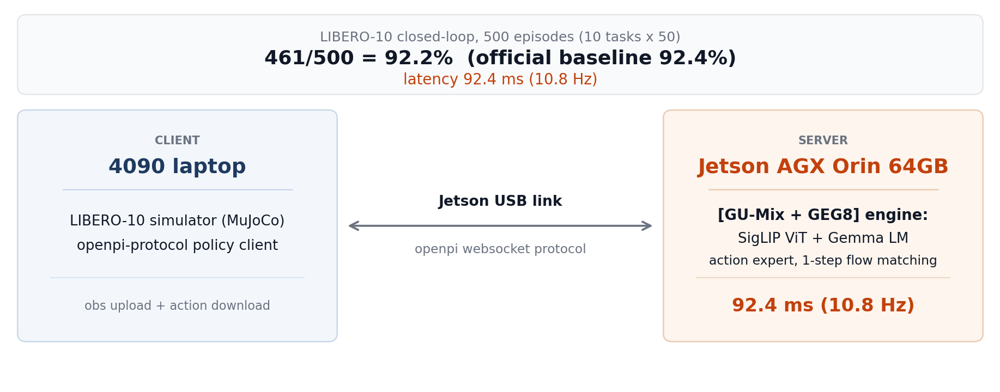
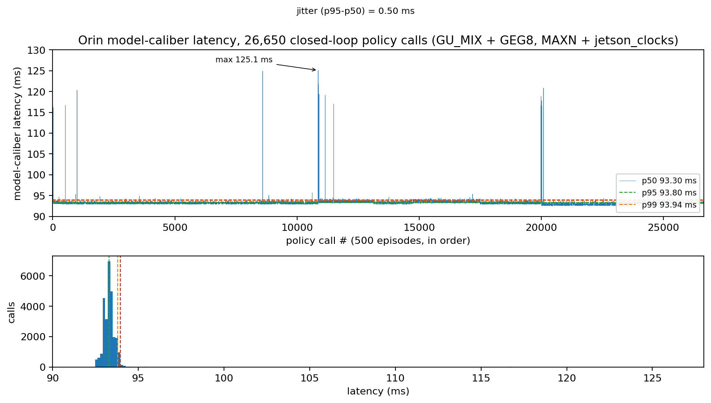
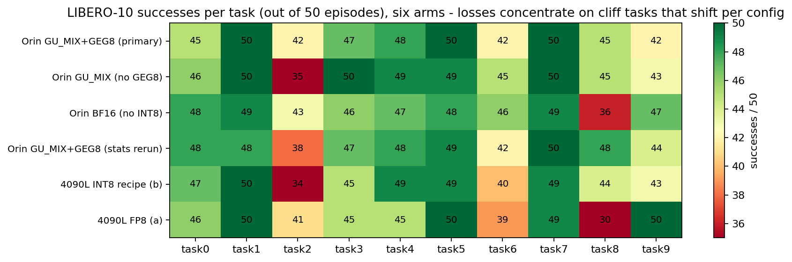

# pi05-orin-edge: pi0.5 VLA on Jetson AGX Orin at 92 ms

Edge deployment of [**pi0.5**](https://github.com/Physical-Intelligence/openpi) (~3.6B) on Jetson AGX Orin: **92 ms** inference latency and **92.2%** LIBERO-10 closed-loop success rate, nearly matching the official baseline (*92.4%*) without quality degradation. The latency comes from an outlier-aware INT8 weight-only path (channel-split outlier handling, fused CUDA kernels, CUDA-Graph 1-step denoising) running on the open-source FlashRT engine, and every number is backed by **full 500-episode** records in this repo.

**Status: Active** - maintained as a research release. Results were last verified on Jetson AGX Orin 64GB (L4T 36.5.0, CUDA 12.6, torch 2.8.0+cu126, python 3.10.12) and on an RTX 4090 Laptop (Ubuntu 22.04, CUDA 12.8, torch 2.8.0+cu128, python 3.10.12); issues and PRs are welcome.

## Demo

Six closed-loop episodes of the shipped recipe on the two-machine topology (LIBERO-10 simulation, not real hardware):

| | | |
|:---:|:---:|:---:|
| <video src="https://github.com/user-attachments/assets/a8906f29-b3e4-4a30-9284-4d69bb4bb2a7" controls muted></video> <br> **task 0 - success** - alphabet soup + tomato sauce into basket, 251 steps / 49 calls | <video src="https://github.com/user-attachments/assets/fc97d46e-22f2-469c-9e15-d356fe790999" controls muted></video> <br> **task 3 - success** - black bowl into drawer + close, 238 steps / 46 calls | <video src="https://github.com/user-attachments/assets/ebcaebf9-d7f1-4b15-ad9c-241011b160e6" controls muted></video> <br> **task 4 - success** - two mugs onto their plates, 208 steps / 40 calls |
| <video src="https://github.com/user-attachments/assets/f365ec43-a502-4d47-85af-85f8c43b5439" controls muted></video> <br> **task 5 - success** - book into the caddy's back compartment, 156 steps / 30 calls | <video src="https://github.com/user-attachments/assets/11b5ffd2-d971-43b1-b4cf-3c9393cfb2a5" controls muted></video> <br> **task 9 - success** - mug into microwave + close it, 257 steps / 50 calls | <video src="https://github.com/user-attachments/assets/dc19b048-961e-4565-abcb-6eccbdaff8de" controls muted></video> <br> **task 2 - failure** - stove + moka pot, 530-step limit (clip = first 30 s of 53 s) |

Each clip pairs the 512x512 agentview render with a live panel whose numbers are read from the committed records at compose time - outcome, steps, policy calls, per-episode client round-trip mean, and the 500-episode model-caliber stats. The policy consumes its usual 224x224 downsample of the same camera, and the re-record's own server-side stats (p50 93.76 ms over 577 calls) sit on the committed 500-episode anchor band (p50 93.30 ms over 26,650 calls). The last clip is a real failure: task 2's step-limit timeout, the failure mode behind its 38/50 = 76% rate in the primary 500-episode arm. Per-task JSONs: [benchmark/results/demo_512_rerecord/](benchmark/results/demo_512_rerecord/); masters ship as v1.0 release assets, and [scripts/compose_demo.py](scripts/compose_demo.py) regenerates any clip from a raw episode recording plus the committed task JSON.

**How it fits together**: a two-machine topology - the LIBERO simulator and the openpi-protocol client run on an x86 host, the model server runs on Orin over the Jetson USB link. The server wraps the [FlashRT](https://github.com/flashrt-project/FlashRT) engine (PaliGemma VLM: SigLIP vision tower + Gemma LM, plus the action expert under single-step flow-matching denoise captured in a CUDA Graph); the overlay swaps in the INT8-mixed GEMM path, the fused gate/up+GEGLU epilogue kernel, and the fast-quant plumbing inside that engine.



## Results

> LIBERO-10, 500 episodes(10 tasks x 50), seed 7, replan 5, H=10 chunk, [results data](benchmark/results/README.md).

| Config | Model Infer p50 | Client p50 | LIBERO-10 500ep |
|---|---|---|---|
| [GU_MIX w/ GEG8](configs/gumix_geg8.env)| **92.4 ms** | 113-150 ms | **461/500 = 92.2%** |
| GU_MIX w/o GEG8 | 95.4 ms | 115.3-116.4 ms | 462/500 = 92.4% |
| BF16 arm (no INT8 mix) | - | 218.8-222.4 ms | 459/500 = 91.8% |
| Orin recipe on RTX 4090 Laptop, INT8 (control arm, [platforms/x86](platforms/x86/README.md)) | 24.78 ms | 26.7-26.9 ms | 450/500 = 90.0% |
| Orin recipe on RTX 4090 Laptop, FP8 W8A16-fp16 ([platforms/x86](platforms/x86/README.md)) | 25.56 ms | 27.4-27.6 ms | 445/500 = 89.0% |
| APXInf (published, same class) | 147.15 ms | - | 92.0% |
| openpi reference | - | - | 92.4% |

The production and the no-GEG8 variant sit within binomial noise of each other (±2.3 pp at N=500), the fused kernel buys -3.2 ms at a noise-level quality delta.

The two RTX 4090 Laptop arms rerun the same protocol with the device as the only variable: both stay within binomial noise of Orin, and on x86 the workload is compute/attention-bound, so the INT8 recipe and FP8 land at the same model p50 (~25 ms, 3.7x Orin) - see [platforms/x86/README.md](platforms/x86/README.md) for the control-variable design, fingerprints, and the full-percentile latency records.

The shipped Orin recipe also holds a full-percentile record from a dedicated 500-episode rerun: p50 93.30 / p95 93.80 / p99 93.94 / max 125.1 ms, jitter (p95−p50) 0.50 ms across 26,650 policy calls on locked clocks - the tail is essentially flat, and the rerun doubles as a second accuracy anchor (462/500 = 92.4%), archived in [benchmark/results/orin_gumix_geg8_stats_500ep/](benchmark/results/orin_gumix_geg8_stats_500ep/).


*Latency record of the tagged stats rerun: 26,650 server-side policy calls from the 500-episode LIBERO-10 closed-loop run on Jetson AGX Orin (GU_MIX + GEG8, locked clocks, October 2026). The tail is flat - isolated spikes reach 125 ms while p99 stays at 93.94 ms. Regenerate with `python3 scripts/make_benchmark_figures.py`.*


*Per-task success counts for the six committed 500-episode arms. Config-level drift stays within binomial noise except on cliff tasks (task2 / task8) that shift per config - the reason every acceptance decision in this repo is made at the 500-episode caliber. Regenerate with `python3 scripts/make_benchmark_figures.py`.*

## What we changed on top of FlashRT

[FlashRT@f2f04db](https://github.com/flashrt-project/FlashRT/tree/f2f04db) is the upstream engine this work builds on; see [NOTICE](NOTICE) and Acknowledgements. 
On top of the overlay is 19 files (4 new + 15 modified, listed in [flashrt_overlay/README.md](flashrt_overlay/README.md)):

- **GU_MIX K16 channel-split INT8**: per-layer 16-channel INT8 gate/up side weights with the BF16 side kept for outlier channels, replacing the naive full-INT8 gate/up that collapsed long-horizon tasks (task8 −48pp / task9 −73pp).
- **GEG8 fused gate/up + GEGLU epilogue** (new CUDA kernel): bit-exact vs the unfused path at three gate levels; -3.2 ms.
- **FAST_QUANT** quantize plumbing (bit-exact, -5.6 ms) + vectorized elementwise + masked-norm + vectorized QKV split.
- **st8 fix**: pass the raw 8-dim normalized state conditioning instead of the 32-pad convention (a v044-era artifact that silently cost accuracy with official weights).
- Production server: warm-start noise shifter, memoized set_prompt, and removal of a duplicated prep block (byte-identical fix, removes a double prompt-embeds upload per request).

## Get started

```bash
# 0. one-time setup (docs/environment.md, docs/pipeline_guide.md)
#    x86 host: LIBERO sim + eval venv; Orin: venv + FlashRT + overlay + build

# 1. download + convert weights (x86)
bash environment/download_lerobot_base.sh
bash environment/download_norm_stats.sh
bash environment/download_paligemma_tokenizer.sh
python3 export/tools/convert_official_weights.py \
  --src ckpts/pi05_libero_base/model.safetensors \
  --out ckpts/pi05_libero_official/model.safetensors

# 2. apply the FlashRT overlay + build on Orin (clones FlashRT @ f2f04db8 + CUTLASS v4.4.2)
bash flashrt_overlay/apply_overlay.sh
#    build commands: flashrt_overlay/README.md

# 3. serve on Orin
source configs/gumix_geg8.env
python runtime/server_flashrt_official_ws.py --views 2 --pool 1 --layers 27 --steps 1 --port 8020

# 4. closed-loop eval (dual-machine: x86 runs the LIBERO simulator + policy client,
#    Orin runs the model server from step 3; the client talks to the server over the
#    Jetson USB link, which is why the client passes the Orin's address as --host)
PYTHONPATH=<openpi>/third_party/libero python benchmark/libero_eval_multitask.py \
  --host <orin-ip> --port 8020    # <orin-ip> = 192.168.55.1 on the stock Jetson USB link
```

[run_pipeline.sh](run_pipeline.sh) chains steps 1-3 with fail-fast guards (downloads, conversion, sync).

## Repo map

| Path | What it is |
|---|---|
| [flashrt_overlay/](flashrt_overlay/) | our 19-file overlay over FlashRT @ f2f04db8 + apply script |
| [export/tools/convert_official_weights.py](export/tools/convert_official_weights.py) | fp32->bf16 bundle converter (byte-exact verified) |
| [runtime/server_flashrt_official_ws.py](runtime/server_flashrt_official_ws.py) | production server (ws / uds / shm transports) |
| [benchmark/](benchmark/) | closed-loop eval (task0 + multitask), parity gate, transport bench |
| [benchmark/results/](benchmark/results/) | full 500-episode records for the six arms (4 Orin + 2 x86) |
| [platforms/x86/](platforms/x86/README.md) | RTX 4090L control-variable campaign (INT8 recipe + FP8) + stats wrapper |
| [platforms/arm64/](platforms/arm64/README.md) | Orin production launcher with latency instrumentation |
| [configs/gumix_geg8.env](configs/gumix_geg8.env) | the 13-env production recipe |
| [environment/](environment/) | version locks + offline wheelhouse + download scripts |
| [tools/](tools/) | K16 mix-set generator + outlier probe |
| [ckpts/](ckpts/) [data/](data/) | upstream artifacts: link-only policy + download table |
| [docs/](docs/) | environment, pipeline, recipe semantics, quantization journey, lessons |

## Scope and limitations

- Single model, single benchmark: pi05_libero on LIBERO-10 only. Nothing here transfers automatically to other pi05 checkpoints or other tasks; every change is env-gated, so adapting the recipe to another variant requires its own closed-loop validation at the 500-episode caliber.
- INT8 here is weight-only (W8A16). Activation-quantized W8A8 was measured and closed (2.73x slower than fp16 GEMM on Orin, [docs/quantization_journey.md](docs/quantization_journey.md)); FP8 exists only in the x86 arm (SM87 has no FP8).
- Client-caliber numbers include the Jetson USB transport (+20-35 ms over model caliber) - the three latency calibers are defined in [docs/recipe.md](docs/recipe.md), and the two are never mixed inside one number.
- Conclusions are bound to the pinned stacks in the status line and to the GPU health-window caveat in [docs/recipe.md](docs/recipe.md): degraded-window latencies inflate 2x+, so latency claims hold only inside a verified healthy window.

## Acknowledgements

- [FlashRT](https://github.com/flashrt-project/FlashRT) (Apache-2.0) - the engine this overlay targets.
- [openpi / pi0.5](https://github.com/Physical-Intelligence/openpi) (Apache-2.0) - model, weights, protocol, LIBERO example.
- [lerobot/pi05_libero_base](https://huggingface.co/lerobot/pi05_libero_base) - the official fp32 weights.
- [LIBERO benchmark](https://github.com/Lifelong-Robot-Learning/LIBERO)
- [CUTLASS](https://github.com/NVIDIA/cutlass) (BSD-3)
- PaliGemma tokenizer - Google big_vision public bucket (Gemma terms of use apply)
