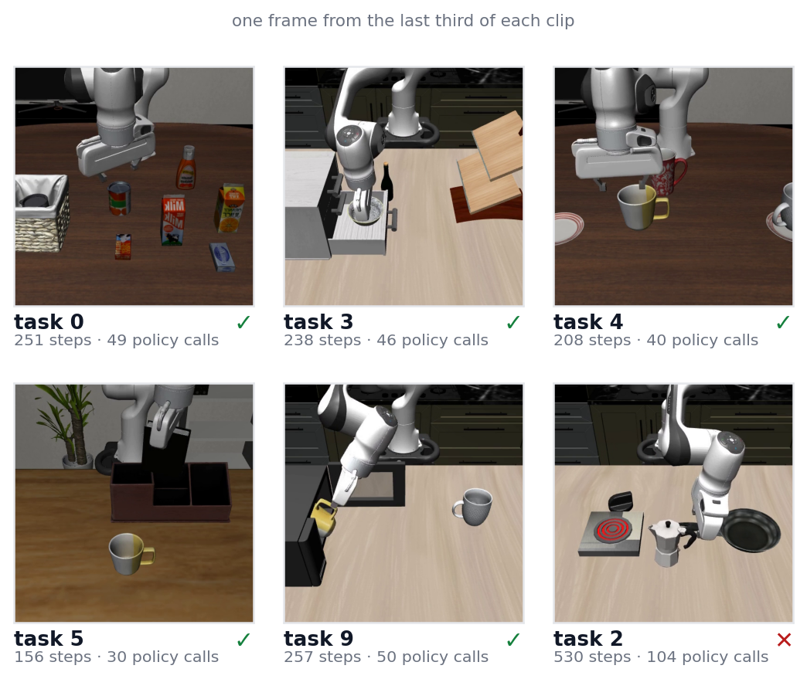
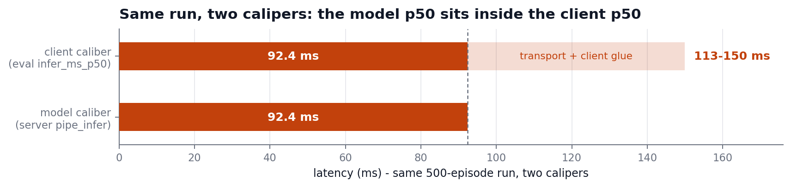
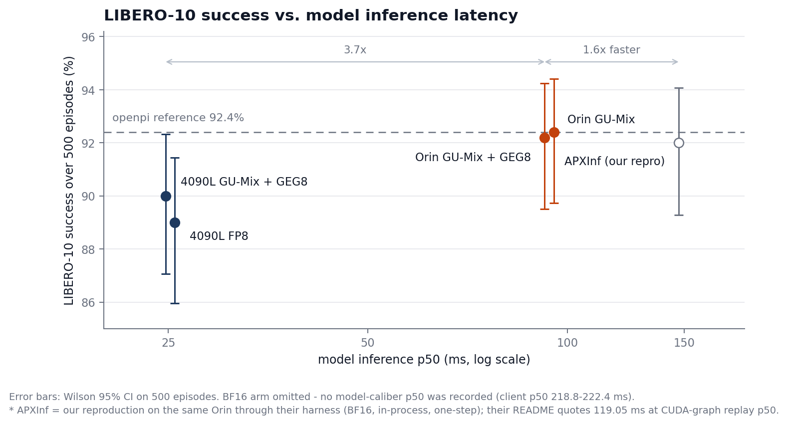
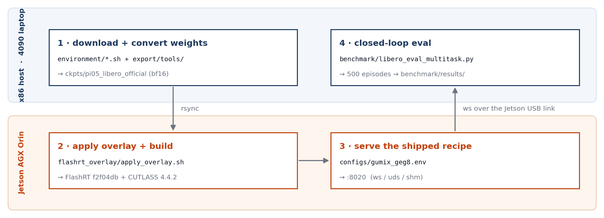

# pi05-orin-edge: pi0.5 VLA on Jetson AGX Orin at 92 ms

Edge deployment of [**pi0.5**](https://github.com/Physical-Intelligence/openpi) (~3.6B) on Jetson AGX Orin: **92 ms** inference latency and **92.2%** LIBERO-10 closed-loop success rate, nearly matching the official baseline (*92.4%*) without quality degradation. 

**Status: Active** - maintained as a research release. Results were last verified on Jetson AGX Orin 64GB (L4T 36.5.0, CUDA 12.6, torch 2.8.0+cu126, python 3.10.12) and on an RTX 4090 Laptop (Ubuntu 22.04, CUDA 12.8, torch 2.8.0+cu128, python 3.10.12); issues and PRs are welcome.

<p align="center">
  
</p>
<p align="center">
  <i><font size="3">Client on a 4090 laptop, GU-Mix + GEG8 engine on Jetson AGX Orin</font></i>
</p>

**How it fits together**: LIBERO and the openpi-protocol client run on an x86 host (a 4090 laptop in our runs), the model server on Orin over the Jetson USB link — the server wraps the [FlashRT](https://github.com/flashrt-project/FlashRT) engine, with the overlay swapping in the INT8-mixed GEMM path, the fused gate/up+GEGLU epilogue kernel, and fast-quant plumbing.

## Demo

<p align="center">
  
</p>

6 closed-loop episodes of the shipped recipe on the two-machine topology in LIBERO-10 simulation MuJoCo.

| | | |
|:---:|:---:|:---:|
| <video src="https://github.com/user-attachments/assets/a8906f29-b3e4-4a30-9284-4d69bb4bb2a7" controls muted></video> <br> **task 0 ✅** - alphabet soup + tomato sauce into basket| <video src="https://github.com/user-attachments/assets/fc97d46e-22f2-469c-9e15-d356fe790999" controls muted></video> <br> **task 3 ✅** - black bowl into drawer + close | <video src="https://github.com/user-attachments/assets/ebcaebf9-d7f1-4b15-ad9c-241011b160e6" controls muted></video> <br> **task 4 ✅** - two mugs onto their plates|
| <video src="https://github.com/user-attachments/assets/f365ec43-a502-4d47-85af-85f8c43b5439" controls muted></video> <br> **task 5 ✅** - book into the caddy's back compartment| <video src="https://github.com/user-attachments/assets/11b5ffd2-d971-43b1-b4cf-3c9393cfb2a5" controls muted></video> <br> **task 9 ✅** - mug into microwave + close it| <video src="https://github.com/user-attachments/assets/dc19b048-961e-4565-abcb-6eccbdaff8de" controls muted></video> <br> **task 2 ❌** - stove + moka pot, *step-limit timeout*|

Each clip's live panel (outcome, steps, policy calls, client round-trip) is read from the committed records; the task 2 clip is the real failure mode — *step-limit timeout*, which accounts for its 38/50 = 76% task rate in the 500-episode arm. Per-task JSONs: [benchmark/results/demo_512_rerecord/](benchmark/results/demo_512_rerecord/); clip masters ship as v1.0 release assets.

## Results

*LIBERO-10, 500 episodes (10 tasks x 50), seed 7, replan 5, H=10 chunk, [results data](benchmark/results/README.md).*

| Config | Device | Model Infer p50 | Client p50 | LIBERO-10 500ep |
|---|---|---|---|---|
| [**GU-Mix + GEG8**](configs/gumix_geg8.env) | Jetson AGX Orin | **92.4 ms** | 113-150 ms | **461/500 = 92.2%** |
| GU-Mix | Jetson AGX Orin | 95.4 ms | 115.3-116.4 ms | 462/500 = 92.4% |
| BF16 | Jetson AGX Orin | - | 218.8-222.4 ms | 459/500 = 91.8% |
| [GU-Mix + GEG8](platforms/x86/README.md) | RTX 4090 Laptop | 24.78 ms | 26.7-26.9 ms | 450/500 = 90.0% |
| [FP8 W8A16-fp16](platforms/x86/README.md) | RTX 4090 Laptop | 25.56 ms | 27.4-27.6 ms | 445/500 = 89.0% |
| [APXInf](https://github.com/RLinf/APXinf-robo) | Jetson AGX Orin | 147.15 ms \* | - | 92.0% |
| openpi reference | - | - | - | 92.4% |

> \* Our reproduction via APXInf-robo's own LIBERO-10 harness (in-process, BF16, warm-start one-step, seed 7); their README reports 119.05 ms at a different caliber (CUDA-graph replay P50). 92.0% = their published 460/500, matched by our 92/100 rerun.


*Model p50 is the first segment of client p50 - the gap is USB transport + client glue.*

### Recipe and ablations

**[GU-Mix + GEG8](configs/gumix_geg8.env)** (shipped recipe): gate/up projections as K16 channel-split INT8 (outlier-heavy channels keep BF16), fused with GEGLU into one CUDA kernel. GU-Mix = same mix, separate GEMMs; BF16 = no quantization.

- Fused kernel: -3.2 ms at a noise-level quality delta (±2.3 pp at N=500).
- 4090 Laptop rows = device-only control; INT8 and FP8 land at the same ~25 ms model p50 (compute-bound) - design and full records in [platforms/x86/README.md](platforms/x86/README.md).


*A 6x latency spread (25-147 ms) moves success at most 3.4 pp, with overlapping Wilson 95% CIs - latency is the axis the arms separate on. (BF16 omitted: no model-caliber p50; APXInf = our reproduction.)*

### Latency profile

Shipped-recipe rerun (500 ep, 26,650 calls, locked clocks): p50 93.30 / p95 93.80 / p99 93.94 / max 125.1 ms, jitter 0.50 ms - flat tail, and a second, independent accuracy anchor (462/500 = 92.4%). Data: [benchmark/results/orin_gumix_geg8_stats_500ep/](benchmark/results/orin_gumix_geg8_stats_500ep/).


*Top: every call in run order (drift/throttling would show as a trend). Bottom: 99% of calls within 0.64 ms of p50; the 1% tail is isolated spikes to 125 ms.*

### Per-task breakdown


*Config drift stays within binomial noise except cliff tasks (task2 / task8) - the reason acceptance decisions are made at the 500-episode caliber.*

## Get started



The four steps as the figure above, split by machine: weights and the overlay cross to the Orin once, then every policy call crosses back over the USB link.

```bash
# 0. one-time setup (docs/environment.md, docs/pipeline_guide.md)
#    x86 host: LIBERO sim + eval venv; Orin: venv + FlashRT + overlay + build

# 1. download + convert weights (x86)
bash environment/download_lerobot_base.sh
bash environment/download_norm_stats.sh
bash environment/download_paligemma_tokenizer.sh
python3 export/tools/convert_official_weights.py \
  --src ckpts/pi05_libero_base/model.safetensors \
  --out ckpts/pi05_libero_official/model.safetensors

# 2. apply the FlashRT overlay + build on Orin (clones FlashRT @ f2f04db8 + CUTLASS v4.4.2)
bash flashrt_overlay/apply_overlay.sh
#    build commands: flashrt_overlay/README.md

# 3. serve on Orin
source configs/gumix_geg8.env
python runtime/server_flashrt_official_ws.py --views 2 --pool 1 --layers 27 --steps 1 --port 8020

# 4. closed-loop eval (dual-machine: x86 runs the LIBERO simulator + policy client,
#    Orin runs the model server from step 3; the client talks to the server over the
#    Jetson USB link, which is why the client passes the Orin's address as --host)
PYTHONPATH=<openpi>/third_party/libero python benchmark/libero_eval_multitask.py \
  --host <orin-ip> --port 8020    # <orin-ip> = 192.168.55.1 on the stock Jetson USB link
```

[run_pipeline.sh](run_pipeline.sh) chains steps 1-3 with fail-fast guards (downloads, conversion, sync); [ckpts/README.md](ckpts/README.md) lists the upstream sources + sha256.

## What we changed on top of FlashRT

[FlashRT@f2f04db](https://github.com/flashrt-project/FlashRT/tree/f2f04db) is the upstream engine this work builds on; see [NOTICE](NOTICE) and Acknowledgements.
The overlay is 19 files (4 new + 15 modified, listed in [flashrt_overlay/README.md](flashrt_overlay/README.md)):

- **GU_MIX K16 channel-split INT8**: the channel-split mechanism behind the GU-Mix rows (Results above); replaces the naive full-INT8 gate/up that collapsed long-horizon tasks (task8 −48pp / task9 −73pp).
- **GEG8 fused gate/up + GEGLU epilogue** (new CUDA kernel): bit-exact vs the unfused path at three gate levels.
- **FAST_QUANT** quantize plumbing (bit-exact, -5.6 ms) + vectorized elementwise + masked-norm + vectorized QKV split.
- **st8 fix**: pass the raw 8-dim normalized state conditioning instead of the 32-pad convention (a v044-era artifact that silently cost accuracy with official weights).
- Production server: warm-start noise shifter, memoized set_prompt, and removal of a duplicated prep block (byte-identical fix, removes a double prompt-embeds upload per request).

## Scope and limitations

- Single model, single benchmark: pi05_libero on LIBERO-10 only. Nothing here transfers automatically to other pi05 checkpoints or other tasks; every change is env-gated, so adapting the recipe to another variant requires its own closed-loop validation at the 500-episode caliber.
- INT8 here is weight-only (W8A16). Activation-quantized W8A8 was measured and closed (2.73x slower than fp16 GEMM on Orin, [docs/quantization_journey.md](docs/quantization_journey.md)); FP8 exists only in the x86 arm (SM87 has no FP8).
- Client-caliber numbers include the Jetson USB transport (+20-35 ms over model caliber) - the three latency calibers are defined in [docs/recipe.md](docs/recipe.md), and the two are never mixed inside one number.
- Conclusions are bound to the pinned stacks in the status line and to the GPU health-window caveat in [docs/recipe.md](docs/recipe.md): degraded-window latencies inflate 2x+, so latency claims hold only inside a verified healthy window.

## Acknowledgements

- [FlashRT](https://github.com/flashrt-project/FlashRT) (Apache-2.0) - the engine this overlay targets.
- [openpi / pi0.5](https://github.com/Physical-Intelligence/openpi) (Apache-2.0) - model, weights, protocol, LIBERO example.
- [lerobot/pi05_libero_base](https://huggingface.co/lerobot/pi05_libero_base) - the official fp32 weights.
- [LIBERO benchmark](https://github.com/Lifelong-Robot-Learning/LIBERO)
- [CUTLASS](https://github.com/NVIDIA/cutlass) (BSD-3)
- PaliGemma tokenizer - Google big_vision public bucket (Gemma terms of use apply)
